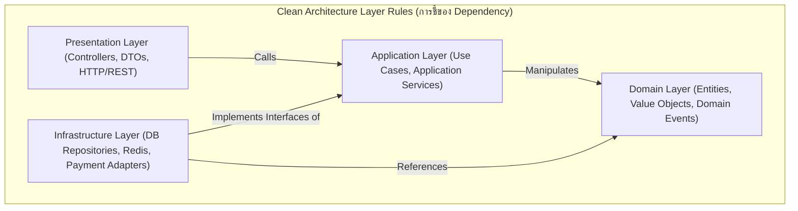
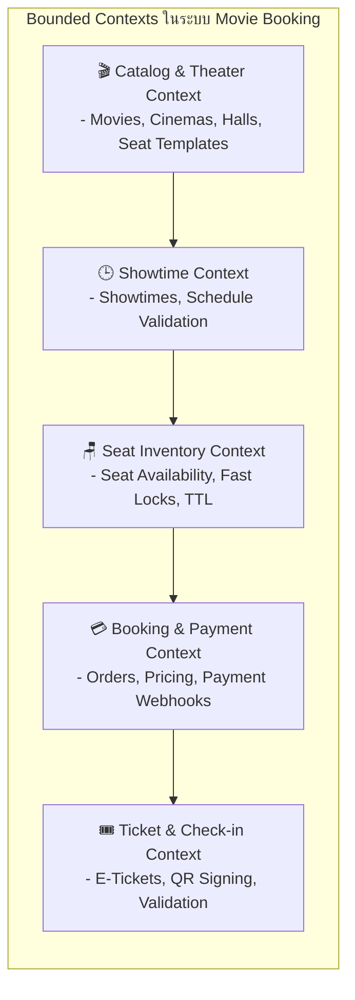
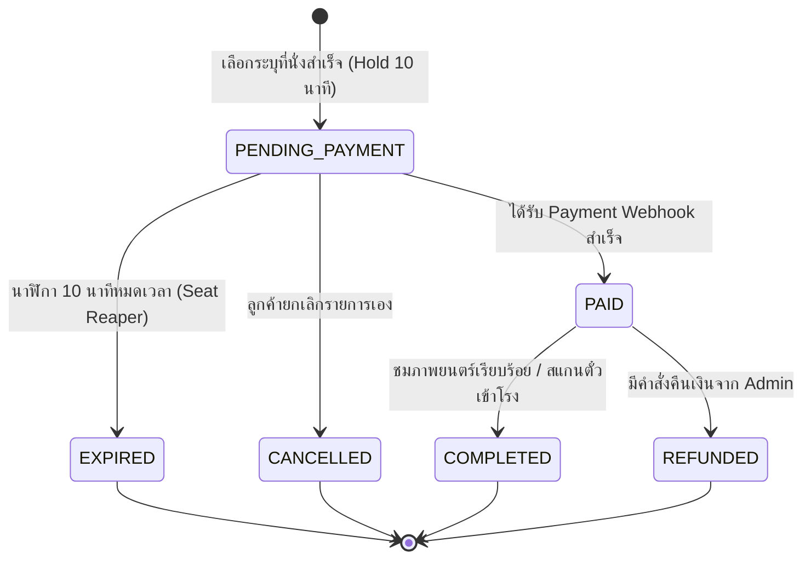

# Software Architecture Document (SAD)
## ระบบจองตั๋วภาพยนตร์ออนไลน์ (Online Movie Ticket Booking System)

**Project:** Movie Booking System  
**Version:** 1.0.0  
**Phase:** Software Architecture (03-software-architecture)  
**Status:** Approved / Ready for Database & API Design  

---

## 1. Architecture Style & Principles

ระบบจองตั๋วภาพยนตร์ออนไลน์ออกแบบโดยใช้สถาปัตยกรรม **Modular Monolith** ผสานกับหลักการของ **Clean Architecture (Onion / Hexagonal Architecture)** ภายในแต่ละโมดูล เพื่อให้มั่นใจใน:
1. **High Cohesion & Low Coupling:** แต่ละโมดูลรับผิดชอบเฉพาะโดเมนของตนเอง (Single Responsibility)
2. **Dependency Inversion (DIP):** เลเยอร์ชั้นใน (Domain & Application) จะไม่ขึ้นกับเทคโนโลยีภายนอก (Database, Redis, HTTP Framework)
3. **Testability:** Core Business Logic สามารถทำ Unit Test ได้ 100% โดยไม่ต้องเชื่อมต่อกับ Database หรือ Network จริง
4. **Independent Evolution:** แต่ละโมดูลสามารถแยกออกไปเป็น Microservices ได้อย่างราบรื่นในอนาคตหากปริมาณทราฟฟิกเติบโตสูง



---

## 2. Domain Boundaries & Bounded Contexts (DDD)

เราแบ่งระบบออกเป็น **5 Bounded Contexts** หลัก:



| Bounded Context | Core Entities / Value Objects | หน้าที่หลัก |
|---|---|---|
| **Catalog & Theater** | `Movie`, `Cinema`, `Hall`, `SeatTemplate` | จัดการข้อมูลภาพยนตร์ โรงภาพยนตร์ ผังที่นั่งมาตรฐาน |
| **Showtime** | `Showtime`, `TimeSlot`, `HallPricing` | จัดการรอบฉาย ป้องกันเวลาฉายทับซ้อนในโรงเดียวกัน |
| **Seat Inventory** | `ShowtimeSeat`, `SeatLock`, `SeatStatus` | จัดการสถานะที่นั่งแบบ Real-time และการล็อกชั่วคราว |
| **Booking & Payment** | `Order`, `OrderItem`, `Payment`, `PaymentStatus` | ควบคุม State Machine ของการสั่งซื้อและการชำระเงิน |
| **Ticket & Check-in** | `Ticket`, `QRCodeToken`, `CheckInLog` | ออก E-Ticket พร้อม Signature และตรวจสอบหน้าโรง |

---

## 3. Directory & Module Structure

โครงสร้างโฟลเดอร์ของ Codebase จัดวางให้เห็นการแยกโมดูลและเลเยอร์อย่างชัดเจน:

```text
movie-booking/
├── src/
│   ├── shared/                        # สิ่งที่ใช้ร่วมกันทุกโมดูล (Cross-cutting Concerns)
│   │   ├── domain/                    # Base Entity, ValueObject, Result<T>, DomainEvent
│   │   ├── infrastructure/            # Database Connection, Redis Client, Logger
│   │   └── utils/                     # Cryptography, Time Helpers
│   │
│   ├── modules/
│   │   ├── catalog/                   # 1. Movie & Theater Catalog Module
│   │   │   ├── domain/                # Movie, Cinema, Hall Entities
│   │   │   ├── application/           # GetMoviesUseCase, CreateMovieUseCase
│   │   │   ├── infrastructure/        # PostgresMovieRepository
│   │   │   └── presentation/          # MovieController, MovieDTOs
│   │   │
│   │   ├── showtime/                  # 2. Showtime Scheduling Module
│   │   │   ├── domain/                # Showtime Entity, ConflictPolicy
│   │   │   ├── application/           # CreateShowtimeUseCase, GetShowtimesUseCase
│   │   │   ├── infrastructure/        # PostgresShowtimeRepository
│   │   │   └── presentation/          # ShowtimeController
│   │   │
│   │   ├── inventory/                 # 3. Seat Inventory & Locking Module
│   │   │   ├── domain/                # SeatStatus, SeatLock Entity
│   │   │   ├── application/           # HoldSeatsUseCase, ReleaseSeatsUseCase
│   │   │   │   └── ports/             # ISeatLockEngine (Interface)
│   │   │   ├── infrastructure/        # RedisSeatLockEngine (Lua Script impl)
│   │   │   └── presentation/          # SeatMapController
│   │   │
│   │   ├── booking/                   # 4. Booking & Payment Module
│   │   │   ├── domain/                # Order Entity, OrderState, Money ValueObject
│   │   │   ├── application/           # CreateOrderUseCase, HandlePaymentWebhookUseCase
│   │   │   │   └── ports/             # IPaymentGateway, IBookingRepository
│   │   │   ├── infrastructure/        # StripeOrOmisePaymentGateway, PostgresBookingRepo
│   │   │   └── presentation/          # BookingController, PaymentWebhookController
│   │   │
│   │   └── ticketing/                 # 5. E-Ticket & Verification Module
│   │       ├── domain/                # Ticket Entity, VerificationStatus
│   │       ├── application/           # IssueTicketUseCase, VerifyTicketQRCodeUseCase
│   │       │   └── ports/             # ITicketSigner, INotificationService
│   │       ├── infrastructure/        # HmacSha256TicketSigner, ResendEmailService
│   │       └── presentation/          # TicketController, StaffCheckInController
│   │
│   ├── jobs/                          # Background Jobs / Workers
│   │   ├── seat-reaper.job.ts         # ปลดล็อกที่นั่งที่หมดเวลา (TTL Expiration)
│   │   └── payment-reconciliation.ts  # ตรวจสอบ Order ที่ค้างสถานะ
│   │
│   └── app.ts                         # Server Bootstrap & Dependency Injection Container
```

---

## 4. Key Contracts & Ports (Interfaces)

เพื่อปฏิบัติตาม **Dependency Inversion Principle (DIP)** เลเยอร์ Use Case จะเรียกใช้เฉพาะ Interfaces:

### 4.1 Seat Lock Engine Interface (`inventory/application/ports/ISeatLockEngine.ts`)
```typescript
export interface HoldSeatRequest {
  showtimeId: string;
  seatIds: string[];
  userId: string;
  ttlSeconds: number; // เช่น 600 วินาที (10 นาที)
}

export interface HoldSeatResult {
  success: boolean;
  lockToken?: string;
  expiresAt?: Date;
  failedSeats?: string[]; // ที่นั่งที่โดนแย่งไปแล้ว
}

export interface ISeatLockEngine {
  acquireHold(request: HoldSeatRequest): Promise<HoldSeatResult>;
  releaseHold(showtimeId: string, seatIds: string[], lockToken: string): Promise<boolean>;
  getSeatStatuses(showtimeId: string): Promise<Record<string, 'AVAILABLE' | 'HELD' | 'BOOKED'>>;
  commitPermanentBooking(showtimeId: string, seatIds: string[]): Promise<boolean>;
}
```

### 4.2 Payment Gateway Adapter Interface (`booking/application/ports/IPaymentGateway.ts`)
```typescript
export interface PaymentChargeRequest {
  orderId: string;
  amountInSatang: number; // หรือจำนวนเงินทศนิยม
  currency: 'THB';
  method: 'PROMPTPAY_QR' | 'CREDIT_CARD';
  customerEmail: string;
}

export interface PaymentChargeResponse {
  chargeId: string;
  status: 'PENDING' | 'SUCCESS' | 'FAILED';
  qrCodeUrl?: string; // สำหรับ PromptPay
  paymentUrl?: string;
}

export interface IPaymentGateway {
  createCharge(request: PaymentChargeRequest): Promise<PaymentChargeResponse>;
  verifyWebhook(payload: any, signature: string): Promise<{ orderId: string; status: 'SUCCESS' | 'FAILED' }>;
}
```

### 4.3 Ticket QR Signer Interface (`ticketing/application/ports/ITicketSigner.ts`)
```typescript
export interface TicketData {
  ticketId: string;
  orderId: string;
  showtimeId: string;
  seatNumber: string;
  cinemaName: string;
  hallName: string;
  movieTitle: string;
  startTime: Date;
}

export interface ITicketSigner {
  generateSignedQRCode(data: TicketData): Promise<{ qrImageBase64: string; signatureToken: string }>;
  verifySignature(signatureToken: string): Promise<{ isValid: boolean; payload?: TicketData }>;
}
```

---

## 5. Domain Model & State Machines

### 5.1 Order Lifecycle State Machine
คำสั่งซื้อ (Order) จะมีสถานะที่ชัดเจนและเปลี่ยนผ่าน (Transition) ตามเงื่อนไขที่กำหนดเท่านั้น:



---

## 6. Architecture Decision Records (ADRs)

### ADR-001: Modular Monolith vs Microservices
- **Context:** ระบบต้องการความแม่นยำสูงในการจัดการ Race Condition ของที่นั่ง และทีมพัฒนาต้องการความคล่องตัวในการเปิดตัว V1.0
- **Decision:** เลือก **Modular Monolith** โดยแบ่ง Bounded Contexts ชัดเจนในระดับโฟลเดอร์และ Interface
- **Consequences:** 
  - *ข้อดี:* พัฒนาง่าย ทดสอบง่าย สามารถใช้ Single ACID Transaction ระหว่างการตัด Order และ Ticket ได้ทันที ประหยัดค่าใช้จ่าย Infra
  - *ข้อจำกัด:* ต้องมีวินัยในการห้าม Import ข้ามโมดูลโดยไม่ผ่าน Interface/Public API

### ADR-002: In-Memory Redis Locking ควบคู่กับ PostgreSQL
- **Context:** หน้าจอผังที่นั่งมีคนเปิดพร้อมกันจำนวนมากในช่วงหนังเข้าใหม่ หากใช้ Database Table Lock จะทำให้ DB Connection เต็ม
- **Decision:** ให้ Redis ทำหน้าที่เป็น Fast Gatekeeper (In-Memory Key Expiry) สำหรับสถานะชั่วคราว (`HELD`) และใช้ PostgreSQL บันทึกสถานะถาวร (`PAID` / `BOOKED`)
- **Consequences:**
  - *ข้อดี:* ตอบสนองไว < 10ms ในการล็อกที่นั่ง รองรับโหลดการแย่งกดที่นั่งหลักพันคนต่อวินาที
  - *ข้อจำกัด:* ต้องมี Job คอย Reconcile และ Sync สถานะหาก Redis เกิด Failover

### ADR-003: QR Code Verification ด้วย HMAC-SHA256
- **Context:** E-Ticket ต้องไม่สามารถถูกปลอมแปลงหรือคัดลอกไปทำซ้ำได้ และเครื่องสแกนของพนักงานต้องตรวจตั๋วได้รวดเร็ว
- **Decision:** ใช้การ Sign Payload ตั๋วด้วย Secret Key (HMAC-SHA256) และแนบ Timestamp
- **Consequences:**
  - *ข้อดี:* เครื่องสแกนสามารถ Verify ความถูกต้องของ Signature ได้ทันที แม้ในสภาวะที่เน็ตช้า และบันทึกสถานะ Check-in ได้อย่างปลอดภัย

---

## 7. Architecture Risks & Quality Assurance Plan

1. **Risk of Cross-Module Coupling:** นักพัฒนาอาจเผลอ Import Database Model ของอีกโมดูลหนึ่งมาใช้งานโดยตรง
   - *Mitigation:* ใช้ ESLint Boundary Rules หรือ TypeScript Path Aliases เพื่อป้องกันไม่ให้โมดูล A ดึงโค้ดภายในของโมดูล B
2. **Clock Drift between App Servers & Redis:** ความคลาดเคลื่อนของเวลานับถอยหลัง 10 นาที
   - *Mitigation:* ใช้ Timestamp จาก Server หรือ Redis TTL เป็นเกณฑ์กลาง (Source of Truth) ห้ามใช้เวลาจากเครื่อง Client ในการตัดสินผล
