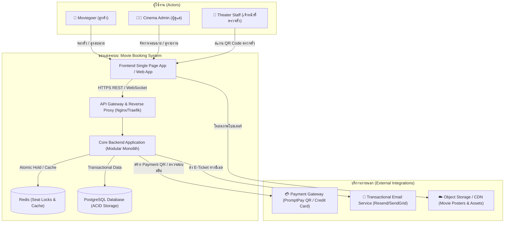
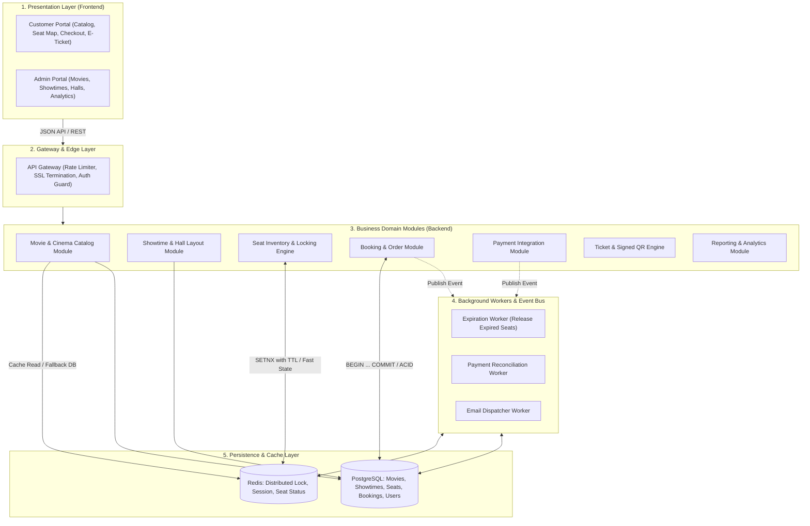
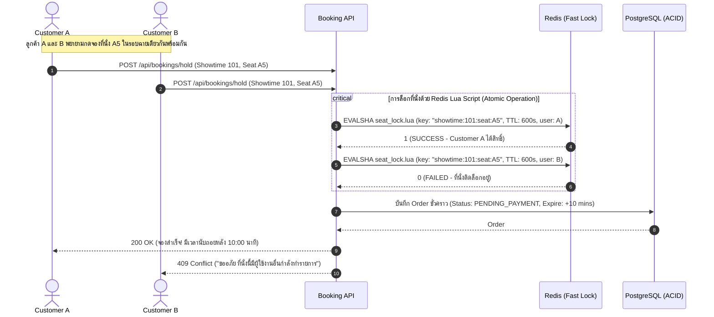
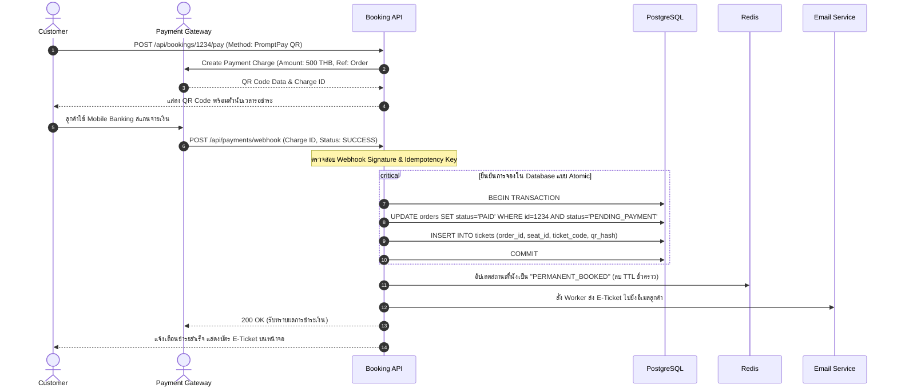
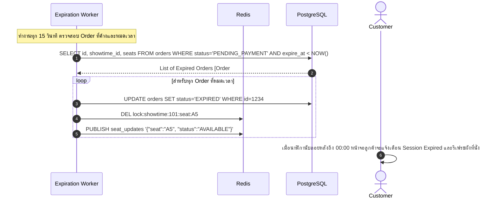

# System Design Document (SDD)
## ระบบจองตั๋วภาพยนตร์ออนไลน์ (Online Movie Ticket Booking System)

**Project:** Movie Booking System  
**Version:** 1.0.0  
**Phase:** System Design (02-system-design)  
**Status:** Approved / Ready for Software Architecture  

---

## 1. System Context & Boundaries

ระบบจองตั๋วภาพยนตร์ออนไลน์ทำหน้าที่เป็นตัวกลางระหว่างผู้ใช้บริการ (Moviegoers), ผู้จัดการโรงภาพยนตร์ (Admin), เจ้าหน้าที่ตรวจตั๋ว (Staff) และบริการภายนอก (External Systems)



---

## 2. High-Level Architecture

เราเลือกสถาปัตยกรรมแบบ **Modular Monolith** ในเวอร์ชัน 1.0 เพื่อความเรียบง่ายในการพัฒนา (Simplicity), ความเร็วในการส่งมอบงาน (Time-to-Market), และความง่ายในการควบคุม ACID Transaction ของการจองที่นั่ง โดยแยกโมดูลตามโดเมนอย่างชัดเจน และรองรับการแยกเป็น Microservices ได้ในอนาคต



---

## 3. Component Decomposition & Responsibilities

| Component Name | หน้าที่และความรับผิดชอบหลัก | เทคโนโลยีที่แนะนำ |
|---|---|---|
| **Web Frontend** | นำเสนอข้อมูลภาพยนตร์, ผังที่นั่งแบบ Interactive (รองรับ Mobile Gesture), หน้า Checkout, นาฬิกาถอยหลัง 10 นาที, และ E-Ticket QR Code | Next.js / React, TailwindCSS, HTML5 Canvas/SVG |
| **API Gateway** | จัดการ Rate Limiting ป้องกัน Bot ปั่นที่นั่ง, ตรวจสอบ JWT Token, และกำหนดเส้นทาง Request | Nginx / Fastify Reverse Proxy |
| **Catalog Module** | จัดการข้อมูลภาพยนตร์, ตัวอย่างหนัง, เรื่องย่อ, เรตติ้ง และข้อมูลสาขา/โรงภาพยนตร์ | REST API Controller & Service Layer |
| **Showtime Module** | ควบคุมตารางรอบฉาย, ตรวจสอบความถูกต้องของเวลาฉายไม่ให้ชนกัน (Schedule Conflict Validator) | Domain Service with Interval Overlap Check |
| **Seat Inventory & Locking Engine** | จัดการสถานะที่นั่ง (Available, Held, Booked), ควบคุม Race Condition ด้วย Atomic Lock และจัดการ Expiry TTL 10 นาที | Redis Distributed Key Engine + In-Memory Lua Scripting |
| **Booking & Order Module** | สร้าง Order Reference, จัดการ State Machine ของ Order (`PENDING` -> `HELD` -> `PAID` / `CANCELLED`), บันทึก Transaction ลง DB | PostgreSQL with Serializable / Repeatable Read Isolation |
| **Payment Module** | เชื่อมต่อ Payment Gateway (PromptPay QR, Credit Card), จัดการ Webhook และ Idempotency Key ป้องกันการจ่ายเงินซ้ำ | Adapter Pattern with Webhook Signature Verification |
| **Ticket & Verification Module** | สร้าง Signed QR Code (เข้ารหัสด้วย HMAC-SHA256) ป้องกันการปลอมแปลงตั๋ว และให้บริการ Endpoint สำหรับ Staff สแกนตรวจตั๋ว | Node.js Crypto / JWT / Sharp QR Generator |
| **Async Workers** | ตรวจสอบคำสั่งซื้อที่หมดเวลาเพื่อปลดที่นั่งอัตโนมัติ (Reaper Job) และส่งอีเมล E-Ticket | BullMQ / Redis Streams / Node-cron |

---

## 4. Concurrency & Seat Locking Strategy

ปัญหาสำคัญที่สุดของระบบจองตั๋วภาพยนตร์คือ **การแย่งกดที่นั่งเดียวกันในเสี้ยววินาที (Race Condition)**

### กลยุทธ์การแก้ปัญหา: Two-Tier Locking (Redis Atomic Lock + DB Transaction)



### Redis Atomic Lock Lua Script Concept:
```lua
-- KEYS[1]: lock:showtime:{id}:seat:{seat_no}
-- ARGV[1]: user_id / booking_token
-- ARGV[2]: ttl_seconds (600)
if redis.call("EXISTS", KEYS[1]) == 0 then
    redis.call("SET", KEYS[1], ARGV[1], "EX", ARGV[2])
    return 1 -- ล็อกสำเร็จ
else
    return 0 -- ล็อกไม่สำเร็จ (มีคนครองอยู่แล้ว)
end
```

---

## 5. Core Sequence Flows

### 5.1 Flow การชำระเงินและออกตั๋ว (Checkout to Ticket Issuance)



### 5.2 Flow เมื่อหมดเวลาชำระเงิน (Seat Hold Expiration & Rollback)



---

## 6. Scalability, Caching & Data Management Plan

### 6.1 Caching Strategy
- **Movie Catalog & Showtime Schedule:** ข้อมูลภาพยนตร์และรอบฉายมีการเปลี่ยนแปลงน้อยมาก แต่ถูกอ่านบ่อยมาก (High Read-to-Write Ratio) 
  - จัดเก็บลง **Redis Cache** ด้วย TTL 10 นาที
  - มี Cache Invalidation ทันทีเมื่อ Admin อัปเดตรอบฉาย
- **Seat Map Real-time Status:**
  - สถานะของผังที่นั่งถูกดึงจาก Redis Hash โดยตรงเพื่อลดภาระของ PostgreSQL ในช่วงที่มีคนเปิดดูผังพร้อมกันหลายร้อยคน

### 6.2 Database Scalability & Connection Pooling
- ใช้ **PgBouncer** เป็น Connection Pooler เพื่อรองรับ HTTP Request จำนวนมากโดยไม่ให้ Database Server เกิด Connection Exhaustion
- วางโครงสร้าง Schema โดยใช้ Index ที่เหมาะสม เช่น Index บน `(showtime_id, status)` สำหรับการค้นหาตั๋วและรอบฉาย

---

## 7. Availability, Failure Handling & Security Boundary

### 7.1 Failure Scenarios & Self-Healing
| เหตุการณ์ฉุกเฉิน (Failure Scenario) | ผลกระทบ | แผนการจัดการและกู้คืน (Mitigation) |
|---|---|---|
| **Redis Server ดับ** | ข้อมูลชั่วคราวของการ Hold หายไป | 1. ใช้ Redis Persistence (RDB + AOF) หรือ Redis Sentinel<br>2. หาก Redis ล่ม ระบบจะ Fallback ไปใช้ Database Row Lock (`SELECT FOR UPDATE NOWAIT`) ชั่วคราว |
| **Payment Webhook ขาดหาย** | เงินตัดแล้วแต่ Order ค้างเป็น PENDING | 1. เมื่อลูกค้าอยู่หน้าชำระเงิน Frontend จะมี Polling เช็คสถานะตรงกับ API ทุก 3 วินาที<br>2. Reconciliation Worker จะเรียก Query Charge Status ไปยัง Gateway อัตโนมัติทุก 1 นาที |
| **User กดยกเลิกกลางคัน** | ที่นั่งค้างติดล็อก | มีปุ่ม "ยกเลิกการเลือกที่นั่ง" ซึ่งจะส่งคำสั่งไปลบ Key ใน Redis และยกเลิก Order ทันทีโดยไม่ต้องรอครบ 10 นาที |

### 7.2 Security Boundaries
1. **Network Security:** บังคับใช้ TLS/HTTPS 100%, ปิดการเข้าถึง Redis และ PostgreSQL จากภายนอก (เปิดเฉพาะ Private Network / VPC)
2. **Access Control (RBAC):**
   - Public: ดูรายการหนัง, ดูรอบฉาย, ดูผังที่นั่งว่าง
   - Authenticated User: Hold ที่นั่ง, ชำระเงิน, ดูตั๋วของตนเอง
   - Staff: สแกนและอัปเดตสถานะตั๋ว (Check-in)
   - Admin: จัดการรอบฉาย, หนัง, และข้อมูลการเงิน
3. **QR Code Anti-Tampering:** E-Ticket QR Code จะบรรจุ Token ที่ผ่านการเซ็นชื่อดิจิทัลด้วย Secret Key (HMAC-SHA256) พร้อม Timestamp เพื่อป้องกันการดัดแปลงหรือสร้างตั๋วปลอม

---

## 8. Design Trade-offs & Decisions

| หัวข้อการตัดสินใจ | ทางเลือกที่เลือก | ทางเลือกอื่นที่พิจารณา | เหตุผลและ Trade-off |
|---|---|---|---|
| **สถาปัตยกรรมระบบ** | **Modular Monolith** | Microservices Architecture | Modular Monolith เริ่มต้นง่ายกว่ามาก ไม่มีความซับซ้อนของ Distributed Network, Debug ง่าย และสามารถจัดการ Transaction ข้ามตารางได้แม่นยำสูง |
| **กลไกการล็อกที่นั่ง** | **Redis Atomic Lock + TTL** | Database Row-Level Locking ล้วน | Redis จัดการ In-Memory ได้รวดเร็วระดับ Microsecond เหมาะกับการแย่งกดบัตรหลักพันคนพร้อมกัน ไม่ทำให้ Database หลักทำงานหนักเกินไป |
| **การเชื่อมต่อ Payment** | **Direct Gateway Webhook** | Third-party Hosted Checkout | ควบคุม UX/UI บนหน้าเว็บของตนเองได้อย่างสวยงาม ไหลลื่น ไม่หลุดออกจากบริบทของเว็บ |
